# badminton-anim

羽毛球规则 / 知识科普短视频系列的 Manim 动画源码。每一集一个文件夹，成片投放在短视频平台。

## 目录

| 文件夹 | 内容 | 引擎 | 主要场景 |
|---|---|---|---|
| `startup/` | 入门练习：第一版羽毛球场地动画 | ManimGL | `badminton` |
| `yylogo/` | YONEX（YY）Logo 尺规绘制动画，系列片头 | ManimGL | `yylogo_draw`、`DrawingScene`；`yylogoWarmUp.py` 中 `yylogo` 等 |
| `badminton_0/` | 第 0 集：场地尺寸 + 单打发球规则，3D 视角 | ManimGL | `badminton` |
| `badminton_1/` | 第 1 集：双打发球轮换（新手向），含配音、配乐、双语字幕、结尾互动题 | Manim Community v0.22 | `DoublesRotation` |

> ⚠️ 两套引擎不通用：`startup` / `yylogo` / `badminton_0` 使用 **ManimGL**（`from manimlib import *`），
> `badminton_1` 使用 **Manim Community**（`from manim import *`）。请分别在各自的环境中运行，代码不要混用。

## 项目一览

### badminton_1 · 双打发球轮换（新手向）

<table><tr>
<td>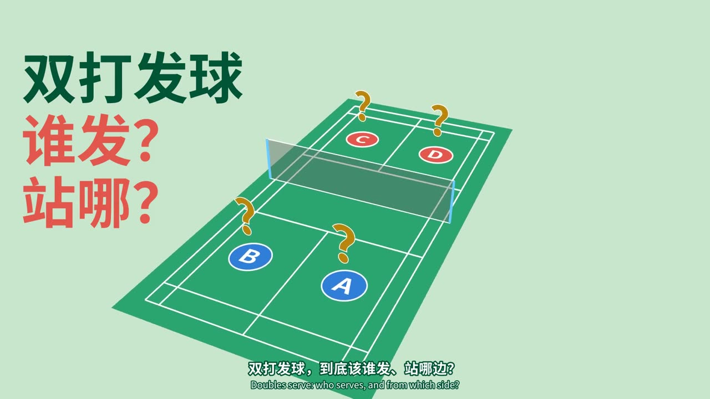</td>
<td>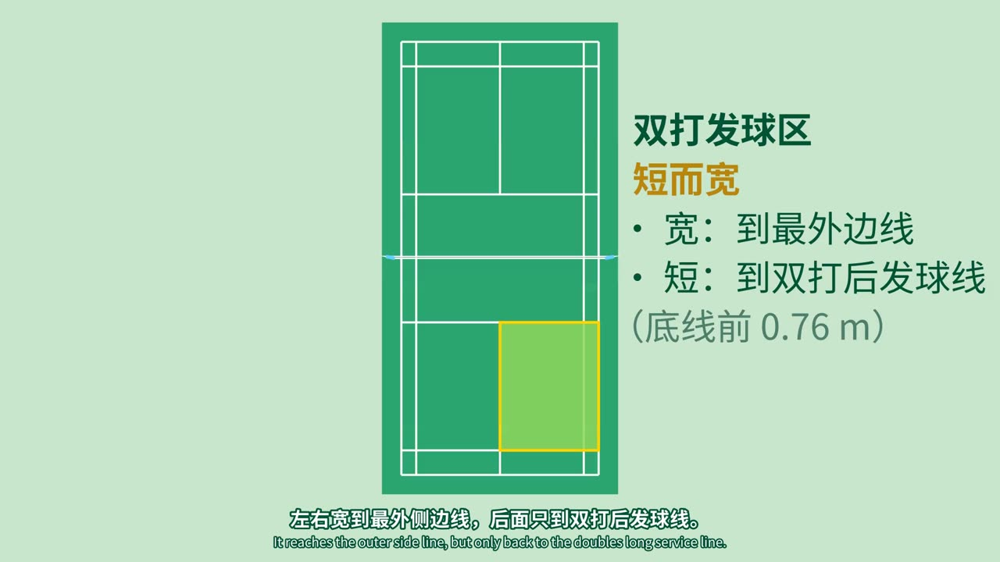</td>
</tr><tr>
<td>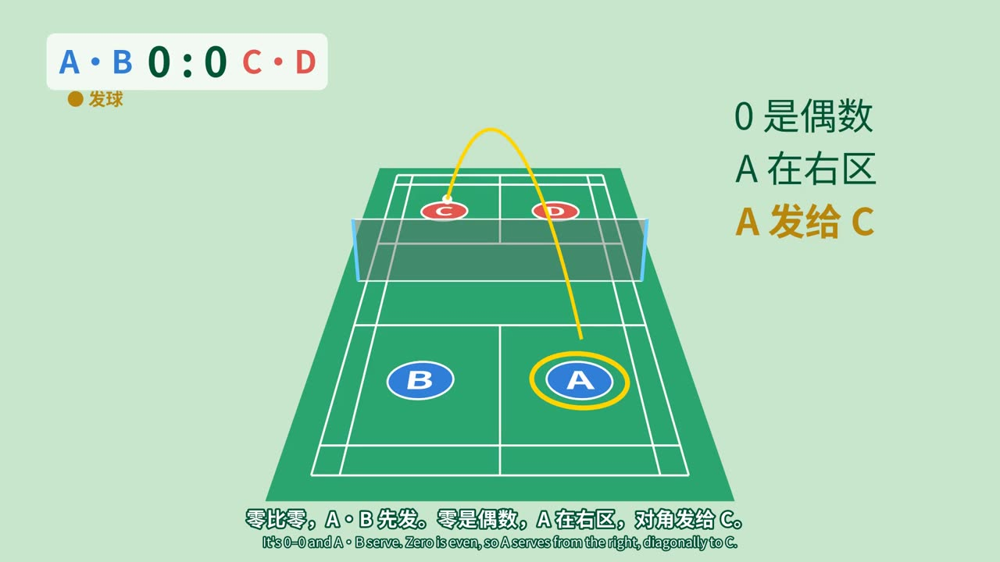</td>
<td>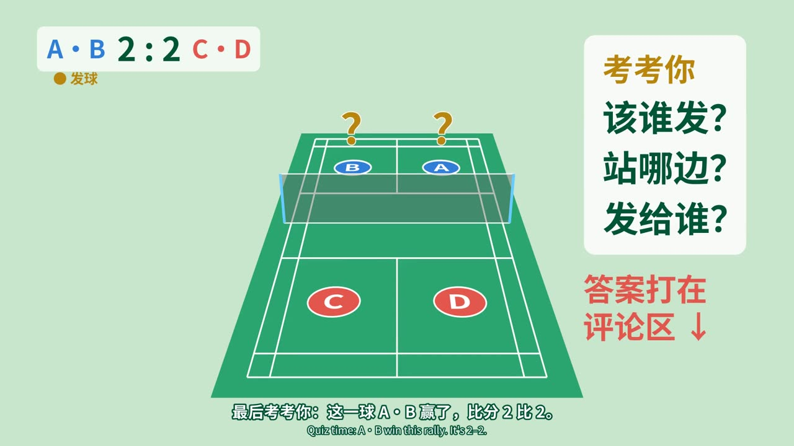</td>
</tr></table>

约 96 秒。开头 3 秒直接抛出问题“双打发球：谁发？站哪？”，镜头同时转到发球人身后。
先用俯视图讲双打发球区“短而宽”，再讲三句话：比分单双定左右，发球方得分换位，接发方得分谁都不动。
接着用第一视角从 0:0 打到 1:2 走一遍，发球权换到对面时镜头绕到 C·D 身后。
最后出一道 2:2 的互动题，引导观众在评论区作答。
配有 AI 配音、合成配乐和中英双语字幕，支持换成自己的录音。

### badminton_0 · 场地与单打发球

<table><tr>
<td>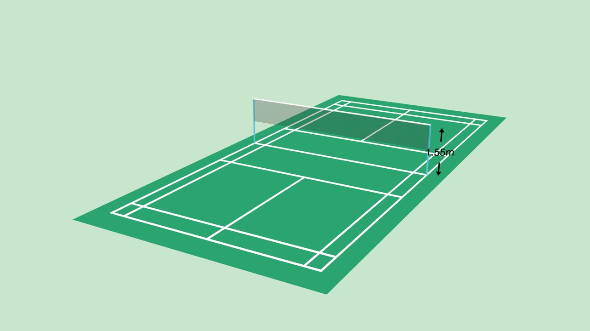</td>
<td>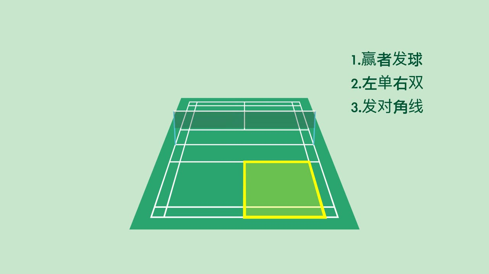</td>
</tr><tr>
<td>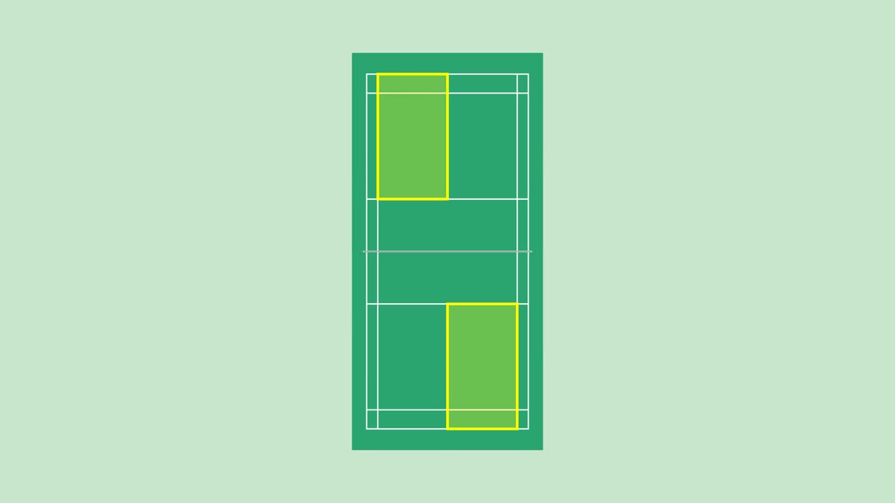</td>
<td>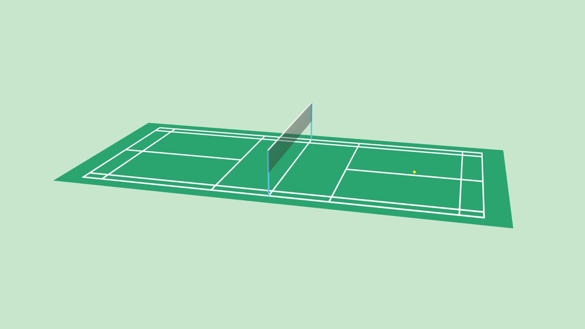</td>
</tr></table>

系列第一集，3D 场景。从场地边框开始逐步画出完整球场，标注球网高度 1.55 m，并在多个视角之间切换。
随后讲单打发球的口诀“赢者发球、左单右双、发对角线”，用黄框高亮发球区，在俯视图里演示对角发球。

### yylogo · YONEX Logo 尺规作图

<table><tr>
<td>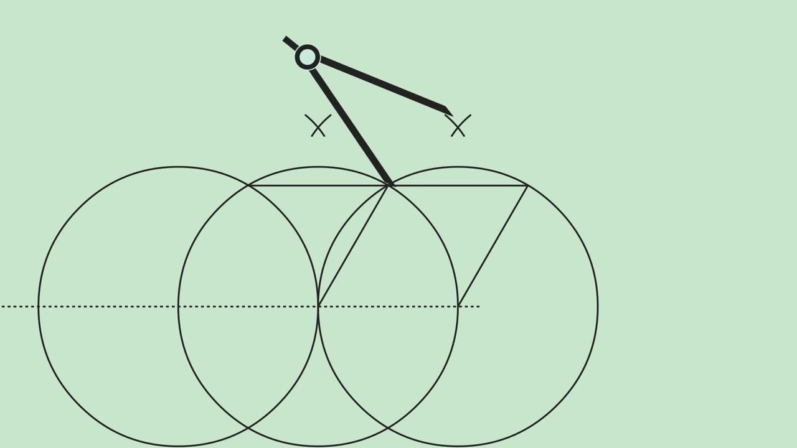</td>
<td>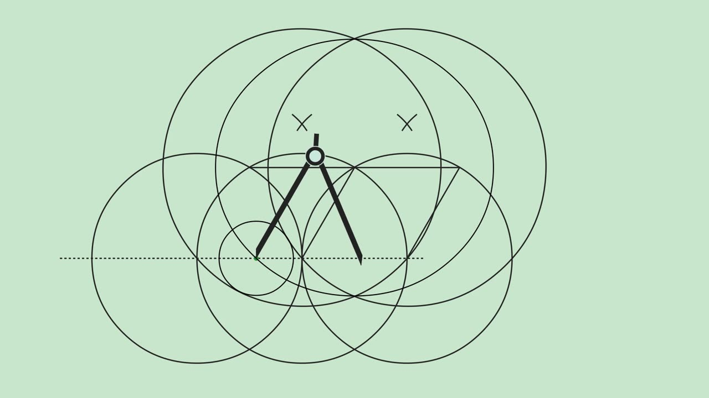</td>
<td></td>
</tr></table>

用自制的圆规（`Compass` 类）和直尺，一步步画辅助圆和交点，复原 YONEX 的 “YY” 标志，最后填色成型。
可以作为系列片头或彩蛋。`yylogoWarmUp.py` 是前期 SVG 描边的练习版本。

### startup · 入门练习

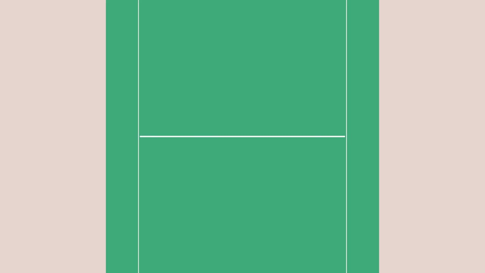

最早的 ManimGL 练习：设置相机，逐条画出场地底色、边线和中线。
`images/` 里保存了早期截图。

## 系列风格

- 背景 `#c8e5cc`（浅薄荷绿），场地 `#2aa570`，白色场地线
- 文字深绿 `#005436`，高亮黄色描边，错误用红色 ×
- 球网半透明灰，网柱 `#66CCFF`
- 俯视讲规则 + 底线后方 3D 第一视角做演示
- 开头 3 秒抛问题做钩子，结尾出互动题引导评论

## 运行

### ManimGL（startup / yylogo / badminton_0）

```bash
pip install manimgl
cd badminton_0
manimgl demo.py badminton          # 预览
manimgl demo.py badminton -w       # 输出视频到 ./videos
```

各文件夹内的 `custom_config.yml` 定义了分辨率、背景色和字体。

### Manim Community（badminton_1）

依赖：`manim`（v0.22）、`edge-tts`、`numpy`、`ffmpeg`。

```bash
cd badminton_1
mkdir -p out
python3 gen_vo.py                                   # 生成配音（或 python3 use_my_voice.py 使用自己的录音）
manim -qh --disable_caching badminton_doubles.py DoublesRotation
python3 subs.py cues.json                           # 字幕
python3 music.py 100                                # 背景音乐
./mix.sh media/videos/badminton_doubles/1080p60/DoublesRotation.mp4 out/final.mp4
```

详见 [`badminton_1/README.md`](badminton_1/README.md)。

## 说明

- 渲染出的 `*.mp4` / `*.mp3` 与 `videos/` 目录已在 `.gitignore` 中忽略，仓库只保存源码、配置和字幕。
